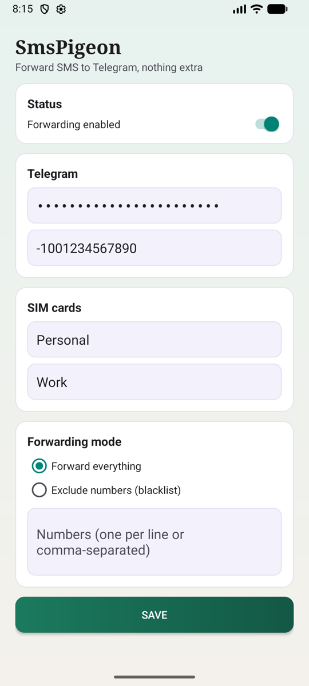

# SmsPigeon

Open-source Android app that forwards incoming SMS to a Telegram chat through your own bot.

Приложение пересылает входящие SMS в Telegram через вашего бота. Interface: English and Russian.

## Screenshots



## Features
- Forwards incoming SMS with sender, text and SIM slot name
- Dual-SIM aware, custom names for SIM 1 / SIM 2
- Forward everything, or exclude numbers (blacklist)
- Runs as a foreground service
- Token and chat id stored in `EncryptedSharedPreferences`; backups are disabled

## Setup
1. Create a bot with [@BotFather](https://t.me/BotFather) and copy its token.
2. Send a message to the bot and find your `chat_id` (for example via `https://api.telegram.org/bot<TOKEN>/getUpdates`).
3. Install the APK from [Releases](../../releases), enter the token and chat id, grant SMS and notification permissions, enable forwarding.

## Privacy and security
- SMS content (including one-time codes) is sent to Telegram in plain message text. Use a private chat only you can read, and treat the bot token as a secret.
- No analytics, no third-party servers: the only network traffic goes to `api.telegram.org`.
- The app requests `RECEIVE_SMS`/`READ_SMS`, so it is intended for sideloading (GitHub Releases / F-Droid), not Google Play.

## Build
Requires JDK 17 and the Android SDK.
```bash
./gradlew assembleDebug
```
Signed release builds run in CI on `v*` tags using secrets `SIGNING_KEYSTORE_BASE64`, `SIGNING_STORE_PASSWORD`, `SIGNING_KEY_ALIAS`, `SIGNING_KEY_PASSWORD`. Verify downloaded APKs against `SHA256SUMS`.

## Contributing
See [CONTRIBUTING.md](CONTRIBUTING.md).

## License
[MIT](LICENSE)
